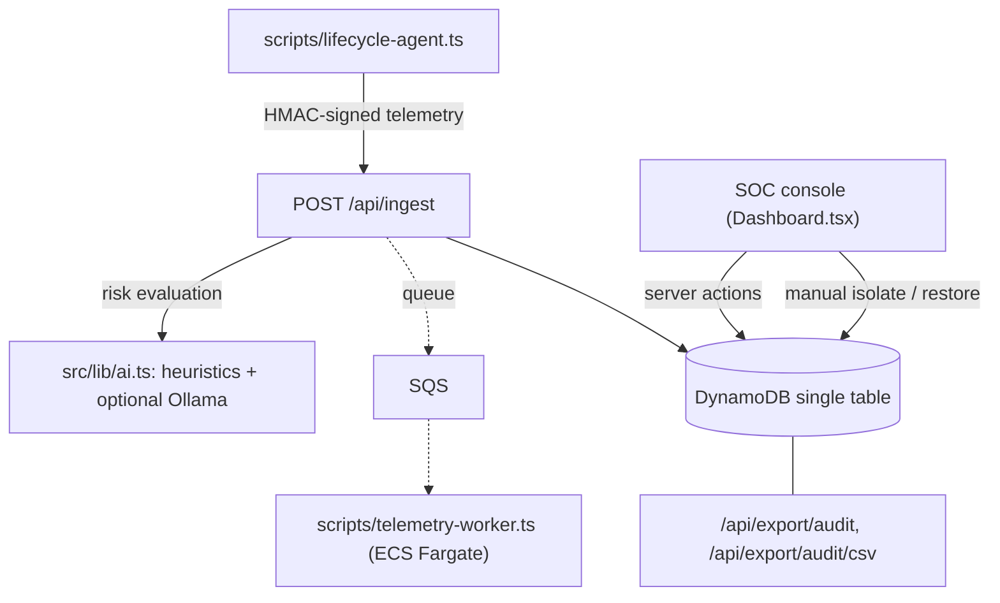

# LifecycleZero

> A Next.js + DynamoDB console that ingests signed telemetry from workstations, flags risky local-AI processes, and lets an admin isolate a host in one atomic transaction — because security teams have no view of what local LLMs do on developer laptops.

**Status:** Hackathon prototype · 161 commits, Jun–Aug 2026, all by Hamza Imran
**Demo:** [Video](https://youtu.be/o0Iphx-f4z8) · [Live app](https://lifecycle-zero.vercel.app)

---

## Architecture & Workflow



1. The agent samples the host and posts telemetry to `/api/ingest`.
2. The gateway evaluates risk with tiered heuristics, optionally calling a local Ollama model (`src/lib/ai.ts`), and writes alerts.
3. An admin reviews alerts in the console and isolates an asset. Isolation updates the asset and writes an audit record in one `TransactWriteCommand` (`src/lib/dao.ts`).
4. An isolated host gets `403 FORBIDDEN_ISOLATED` on its next ingest call.

Isolation is a manual action in the console (single or bulk). Detection only raises alerts; nothing isolates a host automatically.

## Key Features

- **Single-table DynamoDB design:** tenant data keyed by `PK = TENANT#<TenantId>`; GSI1 for employee-to-state lookups; GSI2 as a sparse index holding only alerts (`scripts/provision-db.ts`).
- **Write sharding:** telemetry is spread over 10 shards, `TENANT#<id>#TELEMETRY#SHARD#<0-9>` (`src/app/api/ingest/route.ts`).
- **Signed ingest:** telemetry carries an HMAC-SHA256 signature, checked with a timing-safe compare; the hardware UUID is compared as a string when the request includes one.
- **Atomic isolate + audit:** one transaction changes asset status and writes the audit entry.
- **90-day TTL:** telemetry items carry an expiry timestamp; the table has TTL enabled.
- **Audit export:** `/api/export/audit` (JSON) and `/api/export/audit/csv` (CSV).
- **Risk evaluation:** heuristic rules with an optional local Ollama model and an offline fallback.

## Quickstart & Installation

### Prerequisites
- Node.js 20.9 or newer (required by Next.js 16)
- Docker, for DynamoDB Local

### Setup
```bash
git clone https://github.com/HamzaKhanBUIC/LifecycleZero-Database-Level-Local-AI-Governance-Threat-Isolation.git
cd LifecycleZero-Database-Level-Local-AI-Governance-Threat-Isolation
npm install

npm run db:local              # DynamoDB Local on :8000 (runs docker; keep this terminal open)
npm run db:provision-local    # create table and indexes
npm run db:seed-local         # seed test data

npm run dev                   # terminal 2: Next.js dev server
npm run worker                # terminal 3: queue worker
npm run agent                 # terminal 4: local telemetry agent
```

The README commands were read against `package.json` scripts; they have not been re-run for this documentation pass.

## Configuration & Environment

Read from code in `src/` and `scripts/`. There is no `.env.example` on `main`.

| Variable | Used for |
| :--- | :--- |
| `DB_LOCAL` | `true` points the DynamoDB client at DynamoDB Local (set by the npm scripts) |
| `DYNAMODB_TABLE` | Table name |
| `AWS_REGION` | AWS region |
| `AWS_KMS_KEY_ARN` | Optional KMS key used when provisioning the table and SQS queue (`scripts/provision-*.ts`) |
| `NEXT_PUBLIC_CLERK_PUBLISHABLE_KEY` | Clerk sign-in |
| `NEXT_PUBLIC_SKIP_CLERK` | Skips Clerk for local/sandbox use |
| `AGENT_API_KEY` | Enrollment/ingest key shared with the agent |
| `INGEST_URL`, `TENANT_ID` | Agent: where to post and which tenant |
| `OLLAMA_HOST`, `OLLAMA_MODEL` | Local model endpoint and name (defaults `http://localhost:11434`, `llama3`) |
| `ADMIN_ROTATION_SECRET` | Token for the rotate-key webhook stub |
| `UPSTASH_REDIS_REST_URL`, `UPSTASH_REDIS_REST_TOKEN` | Optional rate-limit backing store |

## Testing & Verification

```bash
npx tsc --noEmit            # typechecks
npm run test:integration    # needs DynamoDB Local running (npm run db:local)
```

There are no unit tests on `main`. The integration script is the only test.

## Architectural Decisions & Trade-offs

- **Single table over several tables:** one table with tenant-prefixed keys keeps tenant queries to one partition key and lets the sparse GSI2 serve alert queries without scans. The cost is a harder-to-read key scheme.
- **Shards over a single telemetry partition:** 10 shards spread burst writes at the cost of fan-out reads.
- **Heuristics first, LLM optional:** rules give a deterministic result with no model; Ollama adds judgment for unfamiliar processes.
- **Manual isolation:** an admin decides, which avoids automatic false-positive lockouts.

## Limitations & Roadmap

- **Telemetry is partly simulated.** In `scripts/lifecycle-agent.ts`, CPU, RAM, the process list and hardware UUID are real. `filesAccessed` and `networkEgress` are generated with `Math.random()` (about 15% of samples are synthetic "threats").
- **"Hardware attestation" is a string compare** of the UUID, skipped if the request omits it. It is not cryptographic attestation.
- **Detection does not isolate.** Isolation is a manual console action.
- **Audit exports are hard-coded** to the sandbox tenant `org_demo_123`.
- **The live app runs in a sandbox mode** that bypasses Clerk by design; do not put real data in it.
- **Known security gaps on `main`:** webhook signatures, tenant selection in server actions and fallback keys are addressed in [open PR #1](https://github.com/HamzaKhanBUIC/LifecycleZero-Database-Level-Local-AI-Governance-Threat-Isolation/pull/1), which is not merged. Until it is, treat this as a demo, not a deployable product.
- Enrollment keys are global rather than per tenant; the rate limiter is in-memory and per instance.
- The dashboard tests Ollama from the browser while evaluation runs on the server, so a local model cannot be used from the hosted app.

## License

MIT. See [LICENSE](LICENSE).
